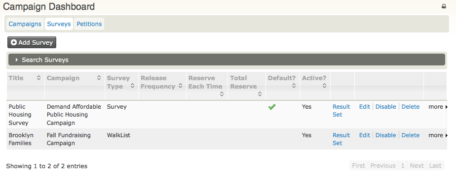
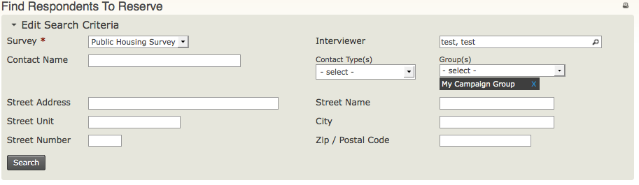
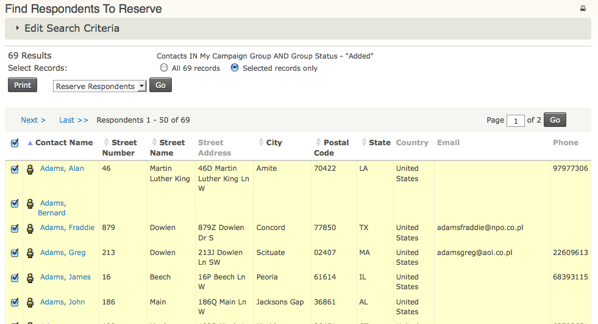
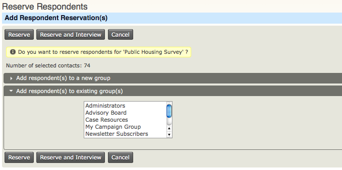
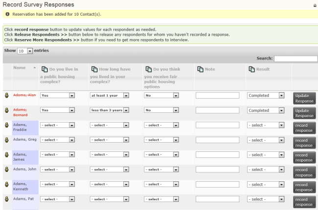

# Everyday survey tasks

## Manage your surveys

To view and edit existing surveys, go to **Campaign > Dashboard > Surveys**. This page shows a summary of your surveys.

Use the links at the right to manage existing surveys, or click **Add Survey** to create a new survey.

## Reserve respondents

Before conducting a survey, determine whom you want to interview. In CiviCRM, this is called reserving respondents. You can divide the reserved group into smaller subsets to make the number of interviews more manageable within available time periods.

To learn how to create a group, see [Groups and Tags](../organising-your-data/groups-and-tags.md).

1. Go to **Campaigns > Reserve Respondents.**
2. From the **Survey** dropdown menu, select the name of the survey (required).
3. From the **Group(s)** dropdown menu, select the name of the group of contacts to be interviewed.
4. You can enter additional criteria to limit your search to a geographic area, such as Street Address, Street Name, Street Unit, Street Number, City, or Zip/Postal Code.

    !!! note
        CiviCRM will parse a street address into Street Name, Street Unit,
        Street Number - which is extremely useful if you're planning a large
        door-to-door canvass - only if you turn on address parsing by clicking
        on **Administer > Administration Console> Configuration Checklist >
        Address Settings**, then in the **Address Editing** area, check the box
        for **Street Address Parsing**.)

5. Click **Search.**

On the Find Respondents to Reserve search results screen:

1. Select the individual contacts to be interviewed, or select all contacts by clicking the radio button for **All *n* records** (where *n* is the number of contacts found in the reserve respondents search).
2. Click **Go** to reserve the respondents.

On the Reserve Respondents screen, click **Reserve**.

## Interview respondents

1. Click **Campaign > Interview Respondents**.
2. On the **Find Respondents to Interview** screen, use the same criteria as for Reserve Respondents:
   - **Survey:** (required) select the name of the survey.
   - **Group(s)**: select the name of the group of contacts to be interviewed.
   - Click **Search**.
3. On the search results screen, select the individuals for whom you want to record responses, or select **All *n* records** (where *n* is the number of contacts found in the reserve respondents search).
4. Click **Go** to record survey responses.
5. On the Record Survey Responses screen, record each individual's responses to the questions.
6. In the **Result** column, select the status of responses to the survey, such as 'Completed, No Answer'.
7. Click **Record Response**, then choose one of the following:
   - Click **Done** if you have finished recording responses and want to return to the Find Respondents to Interview screen.
   - Click **Release Respondents** if you decide not to record responses for the contacts. On the Release Respondents screen, click **Release Respondents** so they will no longer be reserved and another volunteer can reserve them for interviews.
   - Click **Reserve More Respondents** to find more contacts to interview.

## Review survey results

At the end of the canvass, a program lead may want to review the survey results. See [Reports and Analysis](reports-and-analysis.md) to learn how to view the report.

<!-- Source: survey/everyday-tasks.md -->
