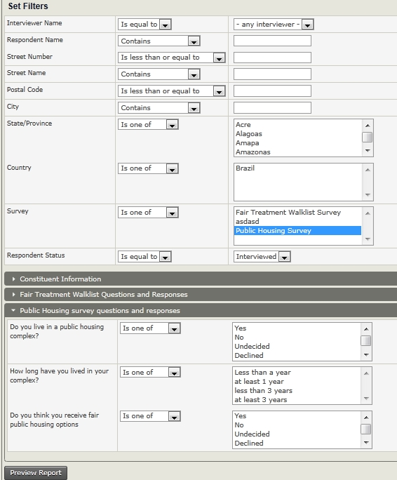
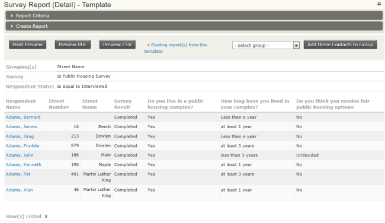
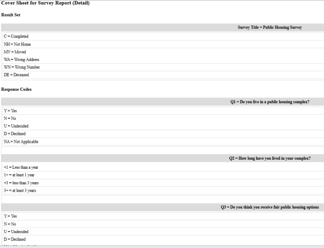
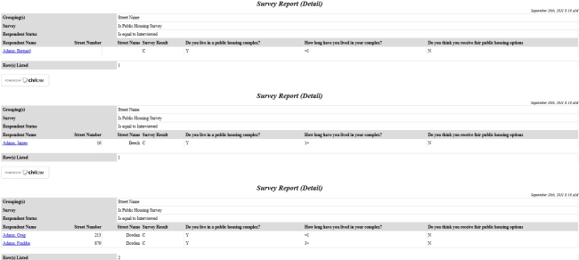

# Survey reports and analysis

You can use the Survey Report (Detail) to analyse the results of your surveys.

## Review survey results in a report

1. Go to **Administer &gt; CiviReport &gt; Create New Report from Template.**
2. Under **Campaign Report Templates** select **Survey Report (Detail)** or click on a survey name on the survey dashboard.
3. On the **Columns** tab, check the boxes for **Survey Responses** and anything else you want to view in the report, such as Street Number and Street Name.
4. On the **Filters** tab, by Survey select the name of your survey, and in **Respondent Status** select **Interviewed**.

    

5. There will be another drop-down area that will be named after your custom data set of questions. You can select responses to questions to limit your report, for example to show all the "yes" responses to one of your questions.
6. Click **Preview Report**.
7. In the **Survey Report (Detail) - Template** screen, you can view the results. You can also export the report information to a CSV file if you want more detailed reporting.

If you would like to see a formatted report with the cover sheet of questions and responses and the street names in ascending order (as you indicated in the survey responses area criteria) then click **Print Preview**.

<!-- Source: survey/reports-and-analysis.md -->
