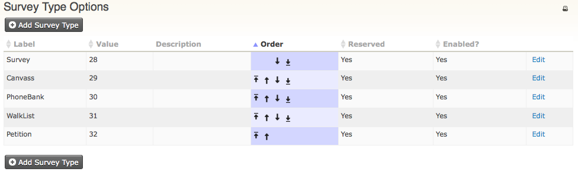

# Set up a survey

To set up a survey, use custom data sets to create the questions and responses you want to capture. Then use a profile to organize the questions as you want them to appear on the survey. If you are connecting the survey to a specific campaign, review the Campaigns section as well.

**Tips:**

- If you plan to conduct many surveys throughout the year (let's say 20 - 30 surveys in a year), with only a few questions per survey (let's say 3-4 questions per survey), create ONE custom data set that includes all the questions for each survey. Then create individual custom profiles that pull in the questions particular to each survey.
- If you plan to conduct just a few surveys per year (let's say about 3-4 surveys per year), with no more than 10 questions per survey, create different custom data sets for each group of questions per survey. Then use custom profiles to pull in the questions particular to a survey.

## Survey types

You can create survey types to describe the type of activity you are conducting. Survey responses are recorded in an activity record for an individual. The default CiviCRM survey types are Survey, Canvass, PhoneBank, WalkList, and Petition.

To create or edit survey types:

1. Go to **Administer &gt; CiviCampaign &gt; Survey Types**.

    

2. Click **Add Survey Type** and complete the form.

## Creating the survey fields

Once you have determined your survey questions and responses, create the custom data fields:

1. Create a custom data field set by going to **Administer &gt; Customize &gt; Custom Data** and clicking **Add a Set of Custom Fields.** To learn more about creating custom field sets, including adding fields with multiple answers, see [Creating Custom Fields](../organising-your-data/creating-custom-fields.md).
2. Create the custom data set(s) so that they are used for **Activities.** The Activity type must be either/or; Canvas, PhoneBank, Survey, Walklist.

    **Hint:** If you plan to do a PhoneBank and want to enter data directly into CiviCRM, you may want to add the phone number to the profile and set it to view only. This lets you see phone numbers while interviewing respondents.

    **Hint:** If you are adding a Walklist survey, you might want to add the full field label but shorter values for each field. These values are used in the printed list of Walklist addresses used by survey collectors, which might make recording responses easier. For example, the full question response label might be &#39;Wrong address&#39; and its value might be &#39;WA&#39;. See [Everyday Tasks](everyday-tasks.md) for more information.
3. Add the questions and any help text you want to provide to the field set. Click **Save** to create the field set for the responses.
4. You can create a profile to hold your questions from the main profile screen, or create the profile when you add your new survey.

## Create a new survey

1. Go to **Campaigns &gt; New Survey**.
2. Enter a Title for your survey. If the survey is part of a campaign, select the campaign from the dropdown menu.
3. Choose the type of **Activity** (e.g. Canvas, PhoneBank, Survey or Walklist).
4. **Instructions for Interviews**: Enter information about the survey that would help the volunteers conducting it.
5. **Maximum Reserved at one time**: Enter the maximum number of contacts that can be reserved at any one time to be interviewed. This lets you divide up the group of individuals for each volunteer to interview at one time.
6. **Total reserved per interview**: Enter the total number of contacts that can be reserved by any interviewer.
7. **Release frequency**: Enter the number of days after which reserved respondents are released if they have not been surveyed.
8. Click **Save**, or **Save and Next** to add questions to your survey.
9. When adding **questions**, you can add two profiles: one to collect information about the contact and one for the survey questions. For either profile, you can select an existing profile, edit or copy an existing profile, or create a new profile. When you create a new profile within a survey, you are taken to a drag and drop profile builder screen. There you can select any individual or activity standard or custom field and add it to your profile. You can rename fields, change their order and other field settings, and name the profile.
10. **Survey Results** are used to record and track the **status** of each completed survey (e.g. Completed, No Answer, Call. If you have created an earlier survey with a survey Result Set you want to use again, select the appropriate Result Set. Otherwise, click **Create a new result set** and enter the status results you want to track for responses to the survey, for example: &#39;Completed, Not Home, Moved, Wrong Address, Deceased&#39;.

<!-- Source: survey/set-up.md -->
