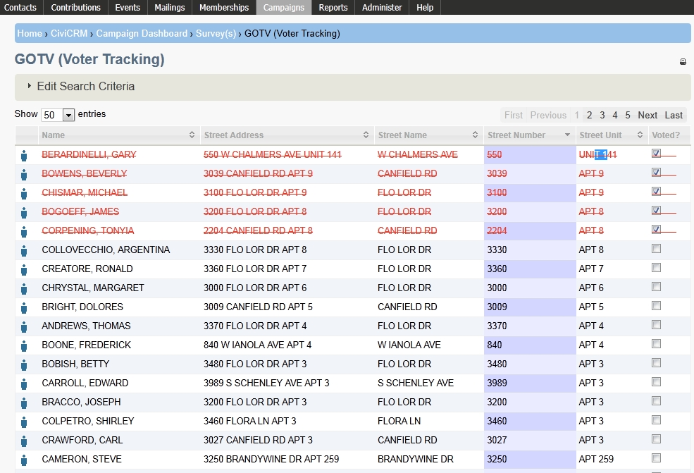

# What is GOTV (Voter Tracking)?

CiviCampaign includes a "Get Out the Vote" GOTV (Voter Tracking) feature for indicating which contacts you have surveyed or plan to survey have voted at the polls.

You need to enable the CiviCampaign component to use GOTV (Voter Tracking). See [CiviCampaign](../campaign/what-is-civicampaign.md) for more information.

## Tracking contacts who voted at the polls

Before using GOTV (Voter Tracking), create a survey, create a group of contacts you plan to interview, and reserve the contacts you want to interview as respondents for that survey. To learn more, see [What is CiviSurvey](what-is-civisurvey.md).

1. Click **Campaigns &gt; GOTV (Voter Tracking**.
2. On the GOTV (Voter Tracking) search screen:
    - **Survey** (required): Select the survey you are using to survey your contacts.
    - **Group(s)**: Select the group of contacts whose voting you want to track.
    - Click **Search.**
3. On the GOTV (Voter Tracking) screen, check the box under **Voted?** next to each individual you know has voted at the polls. You can float your cursor over the "individual contact" icon next to a person's name to find out more about that individual.

<!-- Source: survey/what-is-gotv-voter-tracking.md -->
