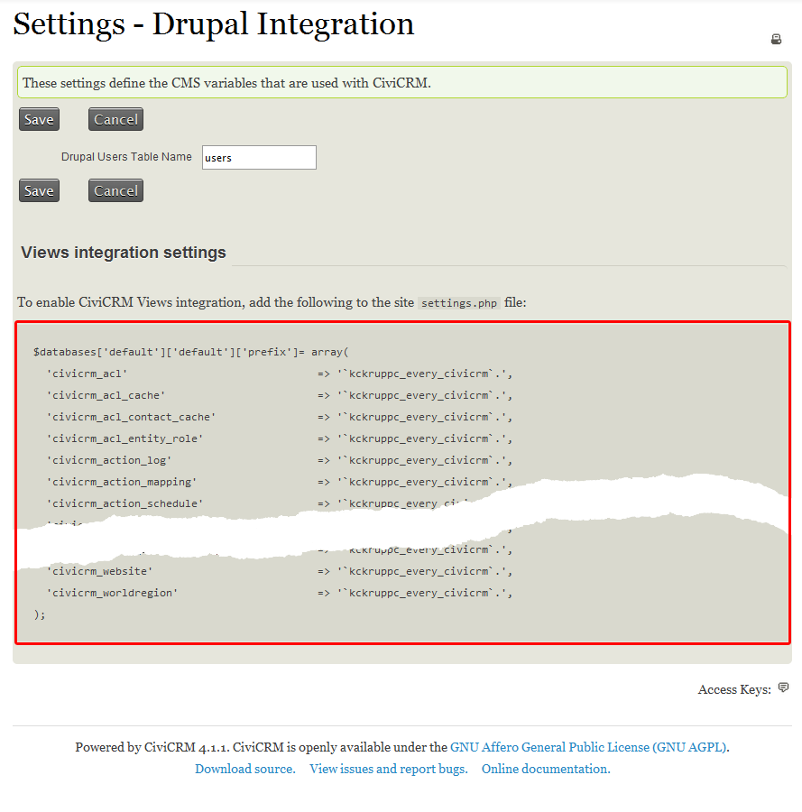
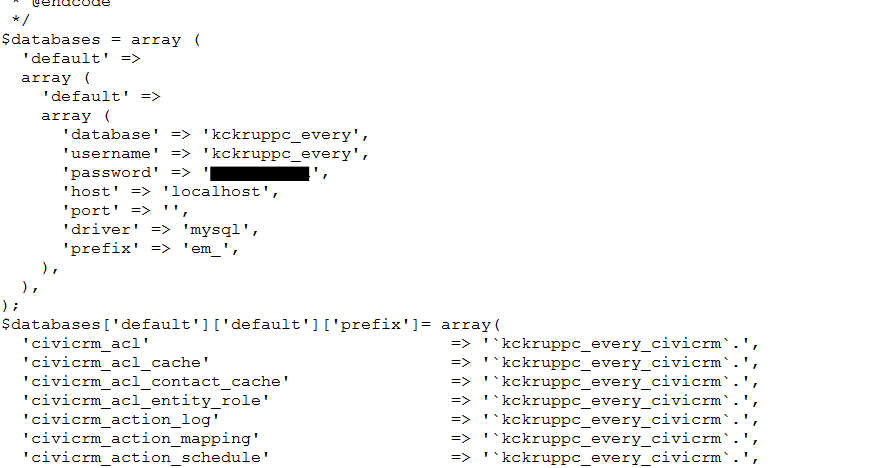
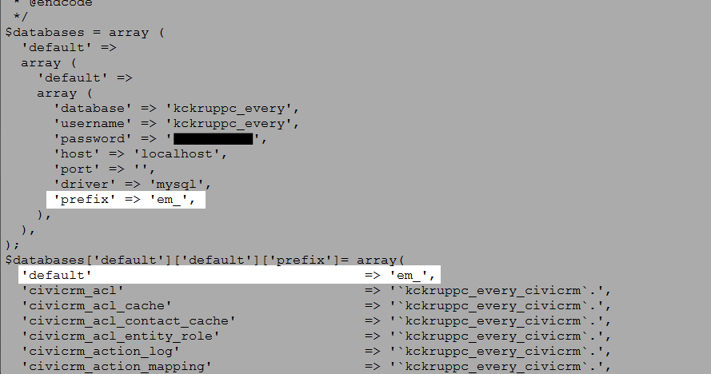
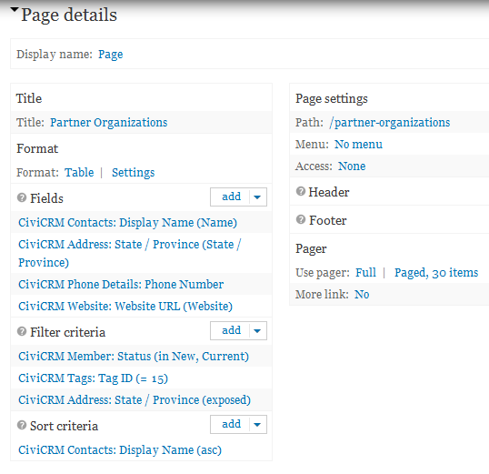

# Views integration

## Drupal Views

[Views](http://drupal.org/project/views) is a Drupal module that displays website content, such as a list of the latest news on a home page. CiviCRM integrates with Drupal Views so that CiviCRM data can be shown on your website.

For example, to create a public page called 'Partner Organizations', you could:

1. Select criteria for the Contact data to display:
    - Organization contacts only
    - Contacts tagged 'Partner' in CiviCRM
    - Contacts with a membership of status 'New' or 'Current'
2. Choose the data to show:
    - Organization name
    - State/Province
    - Website
    - Phone number
3. Show the data in either table or paragraph format.
4. Allow the public to filter the results by State/Province.

This is a simple example; Drupal Views and CiviCRM can be used in other ways.

## Configuration

If CiviCRM and Drupal are in the same database, the steps below are not required. These instructions are for Drupal 7 and Drupal 9+ sites where CiviCRM and Drupal are in separate databases on the same server/container.

Before following the instructions for your Drupal version:

1. Before making any changes, it is *strongly* advised that you make backups of your mysql databases and `settings.php` file.
2. If you have different database users for your CiviCRM and Drupal databases, grant `SELECT` access for each database user to the other database: the Drupal database user to all the CiviCRM tables, and the CiviCRM database user to the Drupal tables. The databases must be on the same server or container for this to be possible.
3. Make sure you are logged into your Drupal site as the administrator.

### Drupal 9

1. In Drupal 9, the civicrm_enity module is also required for Views integrations. Install it with Composer using `composer require 'drupal/civicrm_entity:^3.0@beta'`.
2. Add a `$databases` in `settings.php` or `settings.local.php` similar to:

```PHP
/*
 * Only use if CiviCRM tables are in a separate database
 * The first array index must be 'civicrm'
 */
$databases['civicrm']['default'] = array (
  'database' => 'DB_NAME',
  'username' => 'DB_USERNAME',
  'password' => 'DB_PASSWORD',
  'prefix' => '',
  'host' => 'localhost',
  'port' => '3306',
  'namespace' => 'Drupal\\Core\\Database\\Driver\\mysql',
  'driver' => 'mysql',
);

```

You should now be able to create Drupal Views based on CiviCRM data.

### Drupal 7

1. Visit `http://example.org/civicrm/admin/setting/uf?reset=1`.
2. You should see a page with output that begins with: `$databases['default']['default']['prefix']= array(`

    

3. Copy this setting output, including the trailing `);`.
4. Open `/sites/default/settings.php` for editing from the root directory of the site, typically `public_html` on most servers.

    !!! note
        This assumes you have a single site installation. The location of the settings file might be different depending on whether or not you have multiple sites.

5. Go to the bottom of the file and paste the settings output you copied. If the settings.php file already includes an earlier version of the output, remove the earlier version before pasting the new output.

    

6. You may need to indicate the default prefix. If you see an error like the one below:

    !!! error ""
        PDOException: SQLSTATE[42S02]: Base table or view not found: 1146 Table 'kckruppc_every.semaphore' doesn't exist: SELECT ...

    Include an additional line, `'default' => '<drupaltableprefix>'`, in your `settings.php` just after `$database ['default']['default']['prefix']= array(`. You can find more information on this error in [this forum post](http://forum.civicrm.org/index.php?topic=20910.0).

    

7. Save the file settings.php. You might want to clear your site cache at this point.

You should now be able to create Drupal Views based on CiviCRM data.

!!! note
    If you add a new set of custom fields to CiviCRM, you will need to re-do these steps again so any new fields in the field set can be accessed by Drupal Views.

## Creating views using CiviCRM data

Views are in the **Structure** section of the Drupal administrative menu. When you create a View, give it a name and select what kind of data you wish to show.

If your view focuses on Contacts, which most do, select Show: CiviCRM Contacts. To display details about other CiviCRM data, such as events, relationships, contributions or activities, there are additional options that might provide more data fields for those types.


After creating the View, edit its fields, filters, display and other configurations to show the data as you prefer. Views can take experimentation and/or training to get right. You can ask questions on [Stack Exchange](https://civicrm.stackexchange.com/) or [Mattermost](https://chat.civicrm.org), or [hire a consultant](https://civicrm.org/partners-contributors) if you become stuck.



This is a sample configuration using Views 3 in a Drupal 7 environment. Your View will probably be slightly different, but this provides examples to get started with.

## Other things Views and CiviCRM can do

- Lists of upcoming events
- Building reports on contributions, activities or event registrants
- Honor roll listing of recent donors
- Staff, board of directors or committee lists
- A list of current members
- ...and more!

<!-- Source: integration/drupal/views.md -->
