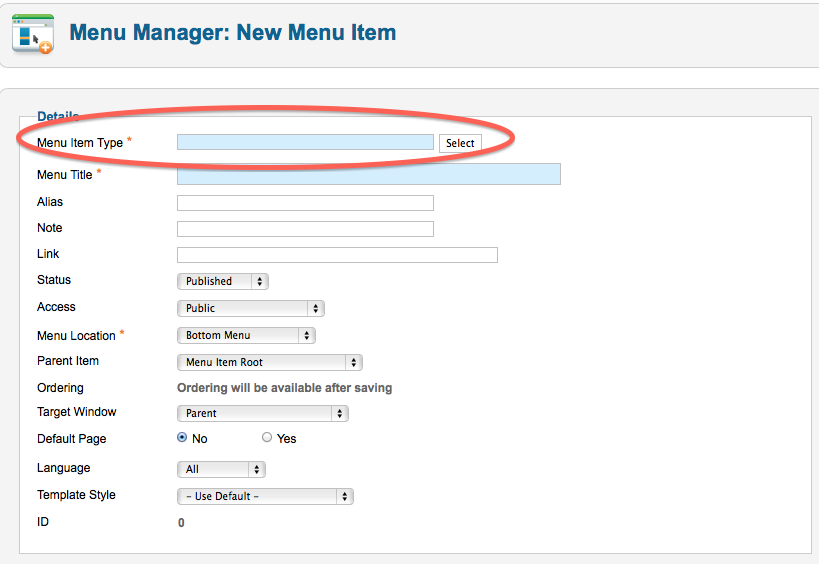
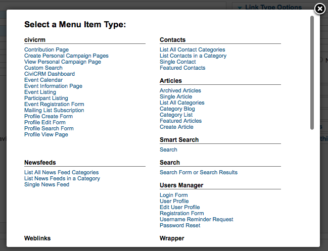

# Integrating with Joomla

CiviCRM integrates with Joomla! as a component. CiviCRM public forms, such as online contribution pages and event registration pages, can be exposed as menu items on the front-end of Joomla! sites using your selected theme. When you are logged in to your Administration site, CiviCRM appears as a menu item under Components.

## Create Joomla! menu items for CiviCRM content

CiviCRM content can be displayed on your website in a couple of different ways. The primary way is to create a specific Menu Item that pulls in CiviCRM data.

1. Within your Joomla! menu, navigate to **Menu &gt; YourMenu &gt; Add New Menu Item**.

   

2. On the Edit Menu item screen, select a menu item type from the civicrm subsection.

   

3. Go to **Basic Options** and select the corresponding CiviCRM page you wish to display.

### CiviCRM menu item types

- **Contribution Page:** A specific contribution or membership page that you would like to publish on your website.
- **Create Personal Campaign Pages:** Provides a direct link for end users to create a personal campaign page tied to a specific contribution page for peer to peer fundraising. For instance, if you had an annual fundraiser called Support CiviCRM and wanted constituents to raise money on your behalf, you could create a Menu Item linking them directly.
- **View Personal Campaign Page:**
- **Custom Search:** Customer Searches can be created.
- **CiviCRM Dashboard:** Shows an end user their related information, such as previous contributions, active and expired memberships, and event registrations. Set the Access level for this menu item to Registered so the end user logs in and CiviCRM knows whose information to display.
- **Event Calendar:** Places all of your current events into a calendar view for the end user.
- **Event Information Page:** Provides summary information for the event you have selected and a link to register directly.
- **Event Listing:** Displays all upcoming events in a list format. You can sort by each column, but there is no search capability by default on the Event Listing.
- **Event Registration Form:**
- **Participant Listing:** If you enabled a participant listing for a specific event, this option displays who will be attending.
- **Mailing List Subscription:** If you configured groups as mailing lists and set their visibility to public, end users can sign up for these mailing lists themselves.
- **Profile Create Form:** You can collect information on your constituents.
- **Profile Edit Form:** A logged-in end user can view information your organization has on record for them, edit it, and save it to CiviCRM. For instance, if you present the **New Individual** profile on your website as a Profile Edit Form, a logged-in end user can view and update their first name, last name and email and save it to your CiviCRM instance.
- **Profile Search Form:** If you configured a profile as a standalone form or directory, an end user can search your database through that profile. For instance, a membership organization could create a group called Members and a profile that limits search results to individuals or organizations in that group, providing a public member directory.
- **Profile View Form:** This menu item type allows you to display information that you have on record for a logged in user. For instance

## Access levels for CiviCRM menu item types

Some menu item types require an end user to be logged in so CiviCRM knows which contact record’s information to present. For example, if John Smith browses your website without logging in and a **Profile View Form** has an Access level of Public, CiviCRM cannot identify him or display his personal information. It presents this error:

!!! error ""
    Could not find the required id parameter (id=) for viewing a contact record with a Profile.

Every Joomla! user that is created has a corresponding contact within CiviCRM. When someone logs in with their Joomla! credentials, CiviCRM can determine which contact’s information to display.

Set a minimum Access level of Registered when creating these CiviCRM Menu Item types, which require an end user to be logged in to Joomla!:

- Profile Edit Form
- Profile View Form
- CiviCRM Dashboard

<!-- Source: integration/joomla/index.md -->
