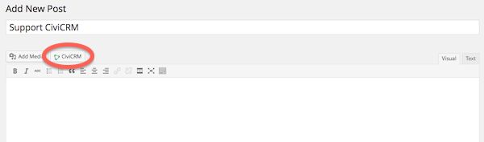

# Integrating with WordPress

CiviCRM integrates with WordPress as a plugin starting with WordPress version 3.3.1 (those using earlier versions of WordPress will need to upgrade prior to installing CiviCRM).

CiviCRM public forms such as online contribution pages and event registration pages will be shown to the public in your selected WordPress theme. When logged in to the WordPress dashboard, CiviCRM will be shown as a link in the left sidebar menu.

## Recommended WordPress Permalink Settings

WordPress by default will use the "Plain" option for the custom URL structure as defined on the page, /wp-admin/options-permalink.php

Using the "Plain" custom URL structure may be incompatible with some CiviCRM page URLs and so is discouraged.

Change this to one of the other URL structure options. In general, it is good for SEO to use either:

- Post name, or
- Custom Structure
- [Clean Urls](https://docs.civicrm.org/sysadmin/en/latest/integration/wordpress/clean-urls/)

## Synchronize WordPress users to CiviCRM contacts

CiviCRM offers a function to synchronize users to contacts: CiviCRM will check each user record for a contact record. A new contact record will be created for each user where one does not already exist. To perform this function go to **Administer -> Users and Permissions -> Synchronize Users to Contacts**.

## Using shortcodes to publish CiviCRM content in WordPress

WordPress shortcodes enable a user to be able to very easily display dynamic content within a WordPress Page or Post with the use of just one line of text ([read more about WordPress shortcodes](http://en.support.wordpress.com/category/shortcodes/)). After installing CiviCRM within your WordPress environment, you can immediately take advantage of CiviCRM specific shortcodes that enable you to display content that relates to contribution pages, event pages, profiles, user dashboards, and petitions. Extensions can also add their own shortcodes. The basic shortcode format is `[civicrm component=X]` with various options, including the ID of the component you want to display.

### Shortcode settings

Starting with version 5.44 CiviCRM now has a setting for "Shortcode Display Mode" under Settings which can be found at `wp-admin/admin.php?page=civi_options`

CiviCRM defaults to `Legacy Base Page Mode`.  When a CiviCRM Shortcode is embedded in a Post/Page without "hijack" being set, it is shown embedded in the content in "Shortcode Mode". If any action is taken via the Shortcode, a query string is appended to the URL and the Post/Page is shown in "Base Page Mode" and the title and content are overwritten. `Legacy Base Page Mode` keeps this existing behaviour while `Remain in Shortcode Mode` preserves the title and content if an action is taken via the Shortcode.

### Shortcodes using the classic editor (WordPress versions 4.9.x and prior)

To add a shortcode either create a new post or new page. If you are using the classic editor (as opposed to the new Gutenberg editor) you will now see a CiviCRM button next to Add Media.

After you click on CiviCRM, you will be able to choose the type of content to display. The options correspond to the types of content in the list below.

Dependent upon the shortcode that you select you will have different sub-options to cater the information to the end user.

### Explanation of available core shortcodes

| Component | Description | Sample shortcodes |
| --- | --- | --- |
| Contribution pages | A contribution page. Option to show preview or live. | `[civicrm component="contribution" id="x"]`. Preview with `mode="test"` |
| Event pages | Either a registration or information page for the event. Option to show live or preview. **Information page:** the summary information about the event including the description as well as the map of the location if you have specified in the event settings. In addition there is a button to register for the event. **Registration page:** bypasses the summary information and displays the page for an end user to register. | `[civicrm component="event" action="register" id="x"]` or `[civicrm component="event" action="info" id="x"]`. Show preview with `mode="test"` |
| Profiles | A page for displaying a user's profile. This can be one of 4 modes - edit, view, create or search. The default is create. **Create:** a blank form on your website that an end user can fill out to create a new contact record. **View:** display contact information to logged in users. For instance, the New Individual profile would show the First Name, Last Name, and Email address. **Edit:** edit an existing contact record. For logged in users it will display their current contact info which they can update. **Search:** displays search boxes for fields on the profile which have been set to searchable. The results are displayed in a list and are publicly available. This is configurable in each field.| `[civicrm component="profile" mode="y" gid="x"]` The `gid` attribute selects which profile group is displayed. |
| User dashboards | The current user's dashboard page. There are no additional options. To identify what related information you have setup to be displayed within the user dashboard i.e. contributions, memberships, etc. navigate to **Administer > Customize Data and Screens > Display Preferences** and select all of the information you would like to have visible to the user. | `[civicrm component="user-dashboard"]` |
| Petitions | A petition form. The only option is to select which petition to display. | `[civicrm component="petition" id="x"]` |
| FormBuilder pages | A [FormBuilder form (afform)](https://docs.civicrm.org/dev/en/latest/afform/form-builder/) page. Where x is the name given to the page, for example: `afsearchMemberDirectory` | `[civicrm component="afform" name="x"]` |

In addition, any of these shortcodes can specify a hijack option (`hijack="1"`) and they will replace all other content on that page rather than being displayed inline.

Keep in mind that prior to being able to display any CiviCRM content on a public website that record will have already been created within CiviCRM.

### Shortcodes in Gutenberg editor (available as a plugin for versions 4.9.x and prior)

The Gutenberg editor is the default editor since WordPress 5.0. Gutenberg is also available as a plugin from [WordPress Plugin Repo](https://wordpress.org/plugins/gutenberg). Gutenberg has a shortcodes block that can be used to insert shortcodes by typing them in. Currently there is no specific CiviCRM block for Gutenberg so there is no interactive way to see the options available for the shortcode. You will need to know the format and look up IDs and options in CiviCRM before creating the shortcode in WordPress.

### Troubleshooting

WordPress users may experience some interference by the WP security plugin [WordFence](https://wordpress.org/plugins/wordfence/) - especially after CiviCRM or WordFence are newly installed. Putting the WordFence firewall feature in learning mode is recommended so WordFence does not block CiviCRM functionality.   Learning mode may be disabled after an initial period of 7 to 30 days.  For more details on WordFence Firewall Learning Mode [refer to their documentation](https://www.wordfence.com/help/firewall/learning-mode/)

<!-- Source: integration/wordpress/index.md -->
