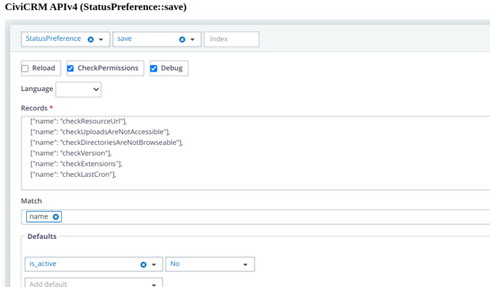
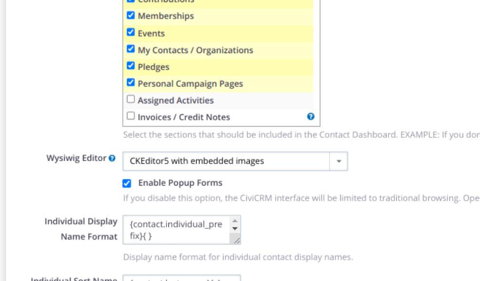

# Running CiviCRM behind a firewall

Running CiviCRM behind a firewall provides greater security, but users who have not been specifically given access cannot reach your CiviCRM site.

If you want to expose forms from your site through the firewall, possible approaches include [CiviProxy](https://docs.civicrm.org/civiproxy/en/latest/) and creating separate forms on your front end server, then importing or using code to bring the data in.

## Configuring your site to work behind a firewall

CiviCRM can expect the server to communicate with external sites or URLs, which will not be possible behind a firewall in most cases. To avoid slowness or problems for users:

1. Disable System Checks that need to pass through the firewall.
2. Potentially use embedded images in your WYSIWYG editor.

### System checks

[System checks](https://docs.civicrm.org/sysadmin/en/latest/setup/#civicrm-system-status) run once a day or so to check your site configuration. Some, such as the version check, rely on information from an external site that cannot be reached through the firewall. These checks often run when a user logs on, and waiting for unsuccessful checks to time out can affect their experience.

There is no UI to disable them permanently, but it is possible to do so with the api. The status preferences are potentially tracked in the civicrm_status_preference table. If no action has been taken to pause or disable them, rows will not exist; if they have previously been 'snoozed', there will be a row. To disable them entirely, create or update the row and set is_active to FALSE. Since we are either updating OR creating, we use the save action.



In the above example output like this is generated (this is the javascript version which can be run through the console in your browser). Note in this case I'm disabling the following:

```javascript
/**
 * These checkes time out, slowly, due to our browser cert config, might be OK on some firewalled sites:
 * checkResourceUrl
 * checkUploadsAreNotAccessible
 * checkDirectoriesAreNotBrowseable
 *
 * These 2 rely on crossing the firewall
 * checkVersion,
 * checkExtensions,
 *
 * Many firewalled sites also manage scheduled jobs 'their own way' & so should disable the cron check.
 * checkLastCron
 */
CRM.api4('StatusPreference', 'save', {
records: [
    [{"name":"checkResourceUrl"}],
    [{"name":"checkUploadsAreNotAccessible"}],
    [{"name":"checkDirectoriesAreNotBrowseable"}],
    [{"name":"checkVersion"}],
    [{"name":"checkExtensions"}],
    [{"name":"checkLastCron"}]],
defaults: {"is_active":false},
match: ["name"]
});
```

## Use embedded images in your WYSIWYG editor

If you create an email with an image on a server behind a firewall and send it to users, they will not be able to access an image uploaded through your WYSIWYG editor if its URL is behind the firewall. One approach is to use [ckeditor5](https://civicrm.org/extensions/ckeditor-5) with the option to use embedded images enabled under Administer->Customize Data and Screens->Display Preferences.

With this enabled, the code to create the image is sent with the email. This can make for larger emails.



<!-- Source: misc/behind-a-firewall.md -->
