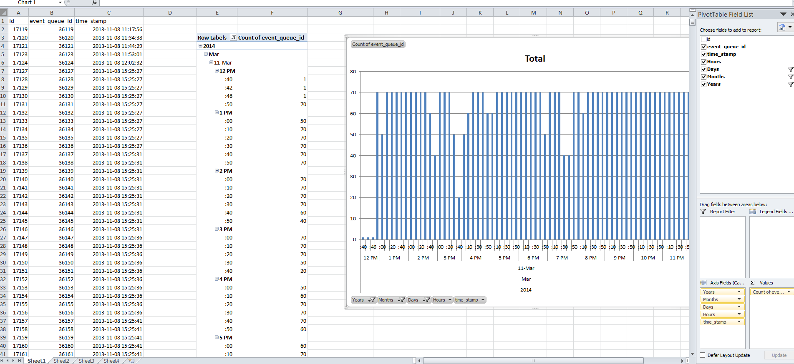

# CiviMail mailer settings

## Mailer settings for the optional CiviMail component

These settings are used to configure mailer properties for the optional CiviMail component. They are NOT used for the built-in "Send Email to Contacts" feature. Refer to the CiviMail Guide for more information.

!!! note "These settings located at:"

    &lt;&lt;yourdomain&gt;&gt;/civicrm/admin/mail?reset=1

**Mailer Batch Limit** - Throttle email delivery by setting the maximum number of emails sent during each CiviMail run (0 = unlimited).

**Mailer Job Size** - If you want to utilize multi-threading enter the size you want your sub jobs to be split into (0 = disables multi-threading and processes mail as one single job - batch limits still apply).

**VERP Separator** - Separator character used when CiviMail generates VERP (variable envelope return path) Mail-From addresses.

**Database Sync Interval** - This governs how often CiviMail records which mail it has sent successfully. A value of 1 means it records every mail, whilst a value of 10 means it writes to the database every tenth email.

A value greater than 1 has possible performance benefits, but if the batch job dies silently, CiviCRM will resend the emails that were not recorded in the database. This means that the mail batch job can get caught in an infinite loop if a batch never completes.

Click **Save** to save your action or **Cancel** to cancel it.

If successful you will see the message "Your changes have been saved."

### Tips for determining a mailer batch limit

Assumptions: The scheduled task "Mailings scheduler" is set to run "always" and runs every time cron runs. If not then adjust accordingly.

1. See if your mail server has a limit. For example many gmail accounts have a limit of 500 emails per hour. Therefore if your cron job runs every 10 minutes or 6 times an hour you can only set the Mailer Batch limit to 500/6 = 83.33 or about 80 rounded down.
2. Even if your mail server is not limiting the amount of email you can send or you already have your limit set appropriately your cron job may time out before delivering that many emails due to things like network speed between your server and the mail server or a low php execution time limit. In this case you will find errors in your apache logs about cron timing out. To determine how many emails are actually being delivered each cron run you can download and analyze the table "civicrm_mailing_event_delivered". For example in Excel you can make a pivot table that counts mailing events per minute out of the downloaded data. If this shows that your server is frequently not able to deliver emails matching your current mailer batch limit you may need to lower it to prevent cron timeouts. You may also want to work with your server or mail server providers to determine the cause of the slow delivery.

For example the attached image shows an Excel pivot table/chart that shows a server that is frquently having problems delivering up to it's limit of 70 emails.

<!-- Source: setup/civimail/outbound-part2.md -->
