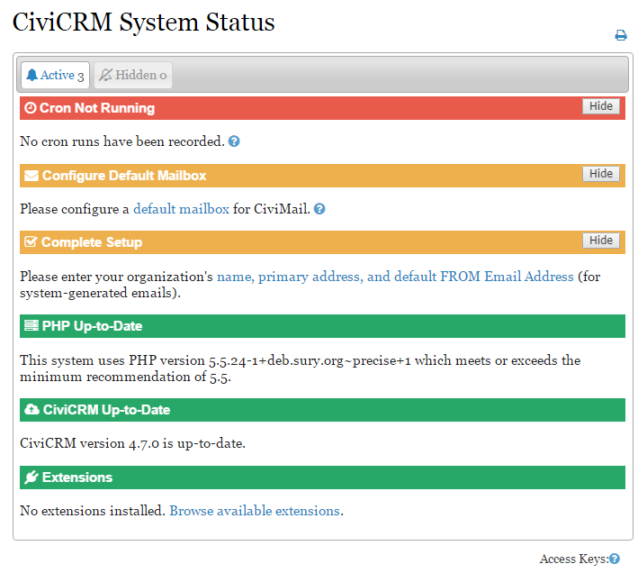

# Setup

## CiviCRM system status

Starting in 4.7, the CiviCRM System Status screen shows the current status of your CiviCRM installation. It is found at **Administer > Administration Console > System Status**.

- Items in *Red* need to be addressed as soon as possible. Red generally indicates something broken that will stop CiviCRM from working normally.
- Items in *Orange* should be addressed as soon as you can. They may stop you from completing key CiviCRM tasks.
- Items in *Green* are set up correctly and appear on the screen for information only.

### Fixing issues

If an issue needs to be addressed, click the link provided or the question mark icon for additional support.

<!-- Source: setup/index.md -->
