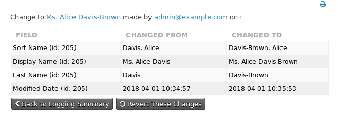

# Detailed logging

Detailed logging (aka "logging") maintains a full history of *all* changes made to *everything* in CiviCRM. It is turned *off* by default because it is more than most organizations need and has some downsides.

## How logging works

- Logging adds many new tables to your database: one `log_`-prefixed table for most existing CiviCRM tables. Cache tables are ignored.
- Optionally, and preferably, you can store the log tables in a separate MySQL database.
- The log tables have extra columns: `log_user_id`, `log_conn_id`, and `log_action`. These describe which user performed the action, the MySQL connection ID, and the action taken.

    !!! note "Further Information"
        More information on changes to what is stored in the `log_conn_id` column can be found in the associated [blog](https://civicrm.org/blog/eileen/who-did-what-when) on this subject.

- The log tables begin by storing the initial values of your CiviCRM tables. Each time a row in a CiviCRM table is added, deleted, or changed, the logging system adds a row to the appropriate log table to fully describe the change.
- The logging system adds 3 triggers to every `civicrm_` table to handle updates, inserts, and deletions.
- Logging does _not_ destroy or change your existing data.

## Performance

Some testing has shown no significant performance degradation. For a large dataset, however, you may need to test performance with logging turned on before releasing it into production. Testing showed no great difference in performance between InnoDB and Archive engine storage.

## References

For more on how logging is enabled and its purpose, see this [blog post](https://civicrm.org/blog/eileen/who-did-what-when).

<!-- Source: setup/logging.md -->
