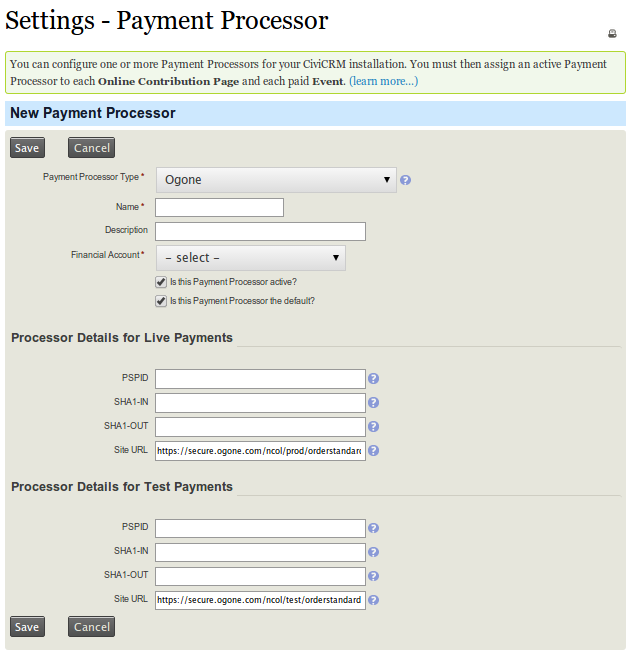
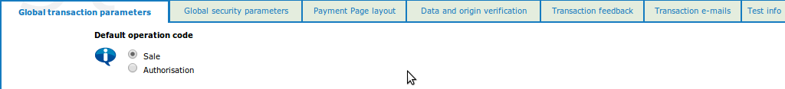
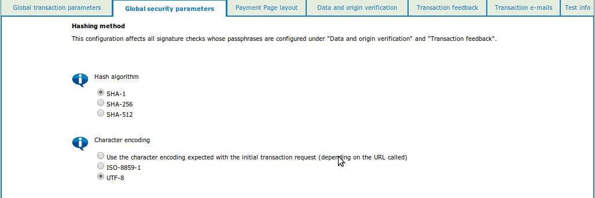
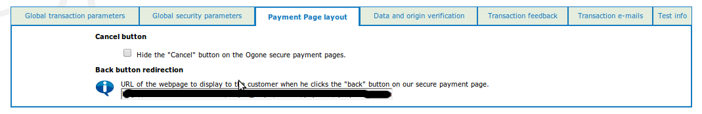
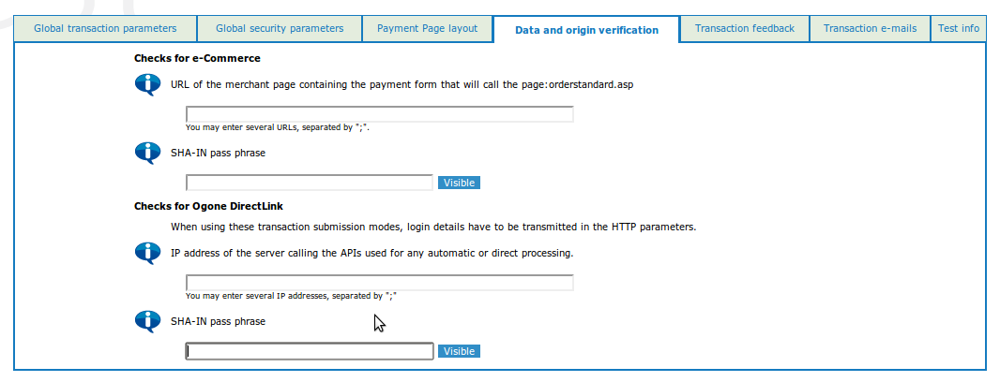
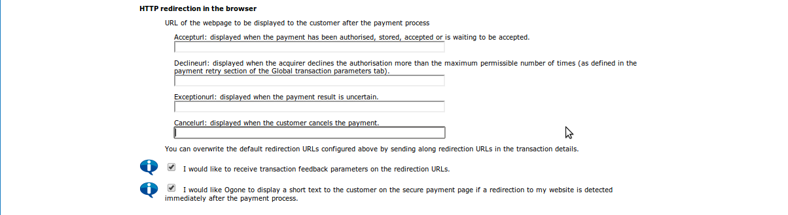
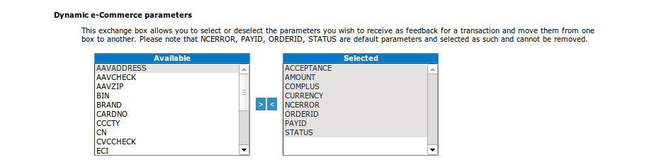
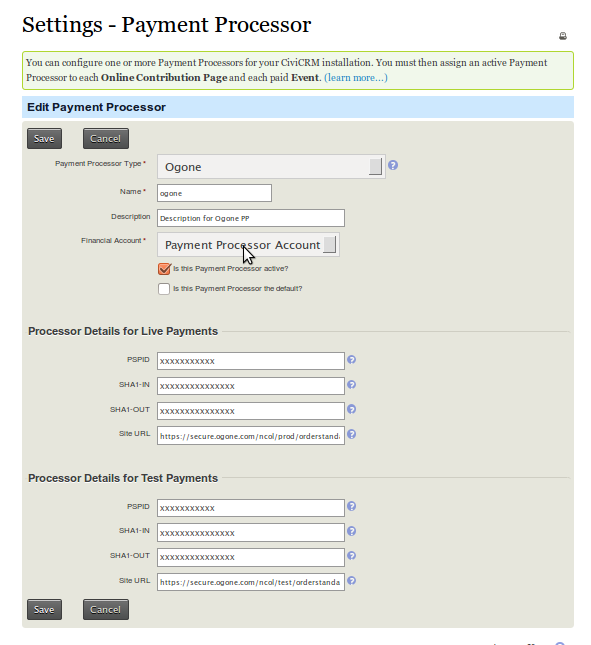

# Setting up Ogone Payment Processor for CiviCRM

This document serves as a brief description of how you go about setting up Ogone to work with CiviCRM.

1. Install the Ogone extension.

1. You should now be able to view the following screen when you set up extension for Ogone Payment Processor.

    

1. The next thing is to configure Ogone payment processor. The following configuration steps are required under your Ogone merchant account.Please ensure you have your merchant account set up on secure.ogone.com before continuing.

    1. Log into the Merchant Resource Center : [Developement](https://secure.ogone.com/ncol/test/admin_ogone.asp) [Production](https://secure.ogone.com/ncol/test/admin_ogone.asp)

    1. Navigate to Technical information >> Global transaction parameters Set your Default operation code as Sale

        

    1. Navigate to Technical information >> Global security parameters - Hash algorithm as SHA-1 - Character encoding as UTF-8

        

    1. Navigate to Technical information >> [Payment Page layout](https://secure.ogone.com/ncol/test/chg_TechInfo_02.asp?CSRFSP=%2Fncol%2Ftest%2Fchg%5FTechInfo%5F02%2Easp&CSRFKEY=DA5428504114C1AE71540B43B58EBE31D67CF719&CSRFTS=20130614151046)- Set your Back button URL

        

    1. Navigate to Technical information >> Data and origin verification-Checks for e-Commercei : Set URL from where your request will call: (else you will get unknown order/1/r/) eg. for contribution: http://example.org/civicrm/contribute/transact for Event: [http://example.org/civicrm/event/register](http://example.org/civicrm/contribute/transact). Set your SHA-IN pass phrase

         

    1. Navigate to Technical information >> Transaction feedbacki. HTTP redirection in the browser Set all URL as : `http://example.org/civicrm/payment/ipn?processor_name=Ogone`

        

        1. Dynamic e-Commerce parameters : Following are compulsory parameters for CiviCRM. 1. ACCEPTANCE 2. AMOUN 3. COMPLUSE 4. ORDERID 5. PAYID 6. STATUS

            

        1. Security for request parameters : Set your SHA-OUT pass phrase its required to verify your transaction before complete.

            

1. The Site URLs namely
    Production: [https://secure.ogone.com/ncol/prod/orderstandard_utf8.asp](https://secure.ogone.com/ncol/test/orderstandard_utf8.asp)
    Test: [https://secure.ogone.com/ncol/test/orderstandard_utf8.asp](https://secure.ogone.com/ncol/test/orderstandard_utf8.asp)
    serve as a means of communication between CiviCRM and Ogone. Your CiviCRM Payment Processor screen should look something like this:

    

<!-- Source: setup/payment-processors/ogone.md -->
