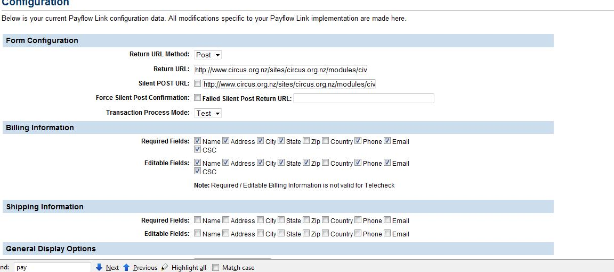
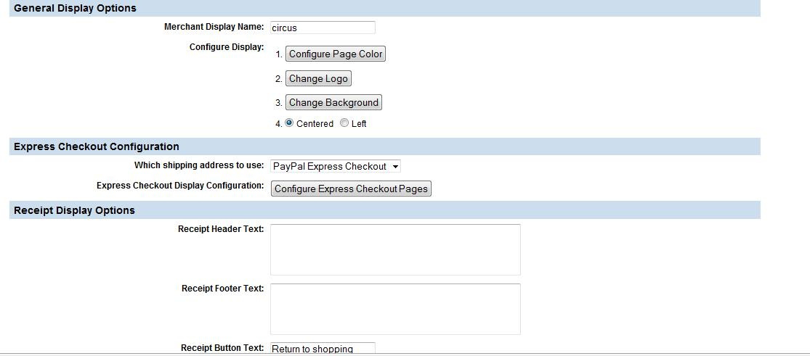
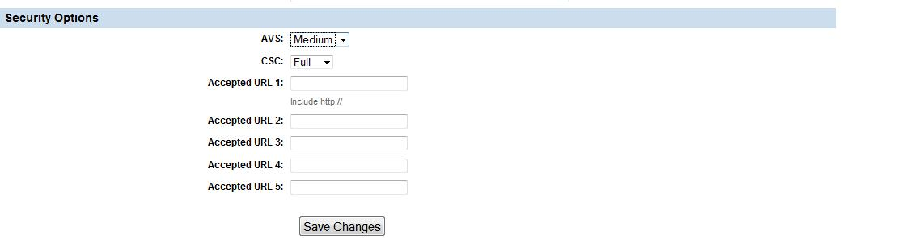
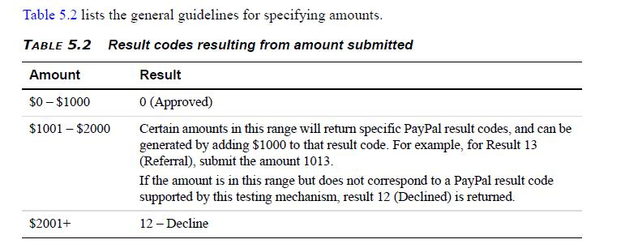

# PayFlow Link

## Payflow Link configuration

Payflow Link is a Paypal offered payment processor which provides off-site processing of payments. You do not require an SSL certificate to use Payflow Link.

The code for Payflow Link is available from the [Extension repository](http://civicrm.org/extensions/payflowlink). Install the extension from `yoursite.com/civicrm/admin/extensions&amp;reset=1`.

## Setting up paypal manager

Payflow Link does not supply test credentials - you need to test with your live credentials in test mode. You can configure your account by logging into [https://manager.paypal.com/](https://manager.paypal.com/).

- Partner = paypal
- Merchant Login = the username you have been supplied
- User = you won&#39;t have one initially (and I haven&#39;t tried to create one)
- Password = the password you have been supplied

There are obviously a lot of things you can configure but the ones I am going to cover are under service settings/ configuration. Also refer to [https://www.paypalobjects.com/en_US/vhelp/paypalmanager_help/configuration.htm](https://www.paypalobjects.com/en_US/vhelp/paypalmanager_help/configuration.htm).



- Return URL Method - you must set this to POST
- Return URL - the standard drupal URL looks something like this. `http://example.org/sites/all/modules/civicrm/extern/payFlowLinkIPN.php`. If you put the URL in your browser you should see &quot;Failure: Missing Parameter&quot;
- Silent Post URL - tick this &amp; set it to the same as the return URL
- Force silent post confirmation - if the server can&#39;t access your website for any reason the transaction will be reversed - I am inclined to think this shouldn&#39;t be enabled
- Transaction Process mode : test or live
- Billing information - the customer will be required to fill out the required fields and given the option of filling out the editable fields
- Shipping information - unless you are shipping product leave these unchecked



There are various presentation options that should be fairly self-explanatory - try here for more [paypal config](https://www.paypalobjects.com/en_US/vhelp/paypalmanager_help/configuration.htm).

### Security



Once again the [paypal config](https://www.paypalobjects.com/en_US/vhelp/paypalmanager_help/configuration.htm) page is a good source of info but note that at the moment csc checking and AVS checking are not supported in that a transaction that fails due to either of these security measures will be voided at Payflow but will be treated as a success by CiviCRM (see proposed improvements). CSC checking is checking the 3 numbers on the credit card. AVS is checking the address supplied against the credit card address.

Accepted URLS - you should put the URL for your site/s in these fields. Only browsers coming from those sites will be accepted.

## Testing

Use test credit card credentials while in test mode: The $ amount you use will determine the pass or failure

- card 4111111111111111
- visa
- any future date



## Limitations / proposed improvements

- GET vs POST. This is common to all off-site processors in Civi at the moment. The recommended behaviour is to send the user off-site using an HTTP POST request which means they can&#39;t see / edit the request. If you have configured Paypal Manager to accept paypal payments then the page they land on will show the civicrm url attributes. If you haven&#39;t they will still be able to use the back button to get to it. CiviCRM does check the invoice id &amp; amount match the contribution number when it succeeds so it is not easy to use this in a malicious way. Your user login it exposed but not your password. Presumably &#39;pay by paypal&#39; links do this al the time. It would be more ideal for the CiviCRM page to POST to payflow. This does require a change in CiviCRM core code &amp; the difficulty is with quickform POSTing to an prescribed URL

  ```text
  TYPE=S&amp;LOGIN=yourloginn&amp;PARTNER=PAYPAL&amp;AMOUNT=1.00&amp;COMMENT1=civicrm contact ID 274&amp;COMMENT2=contribution id 3190&amp;DESCRIPTION=Online Contribution%3A Donate to our fund to buy a Chinese Pole&amp;INVOICE=3190&amp;USER1=274&amp;USER2=2cd150f088d888943596266a890874f6&amp;USER7=contribute, a7147c02b36a45274acba2020a04a798_3305&amp;USER8=1
  ```

- Passing through Billing details: At the moment payflow link is not passing address details backwards &amp; forwards successfully - I think ideally the same billing block would be displayed as on the payment processors that are handled on-site &amp; a new type would be introduced that uses GET
- Potentially AVS &amp; CSV support should be added
- Extension packaging - this is for purposes of future proofing
- Testing - I need to confirm how completely it has been tested - per <https://docs.civicrm.org/dev/en/latest/extensions/payment-processors/create/#testing>

<!-- Source: setup/payment-processors/payflow.md -->
