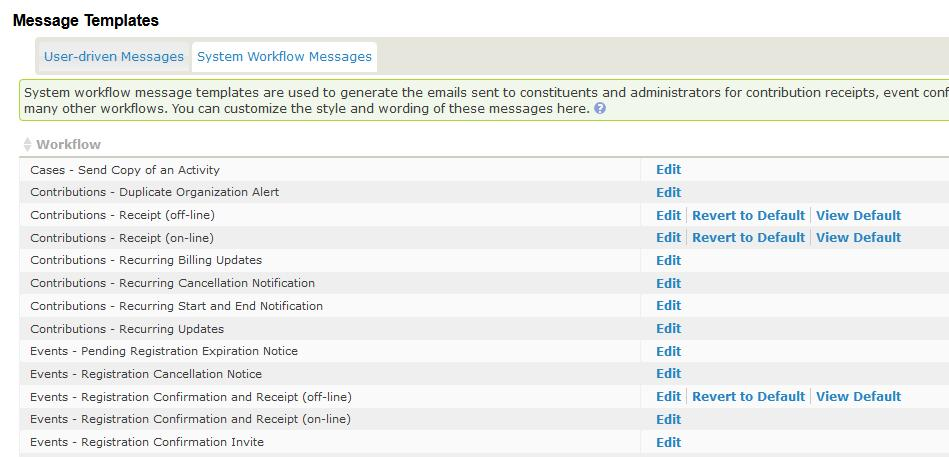
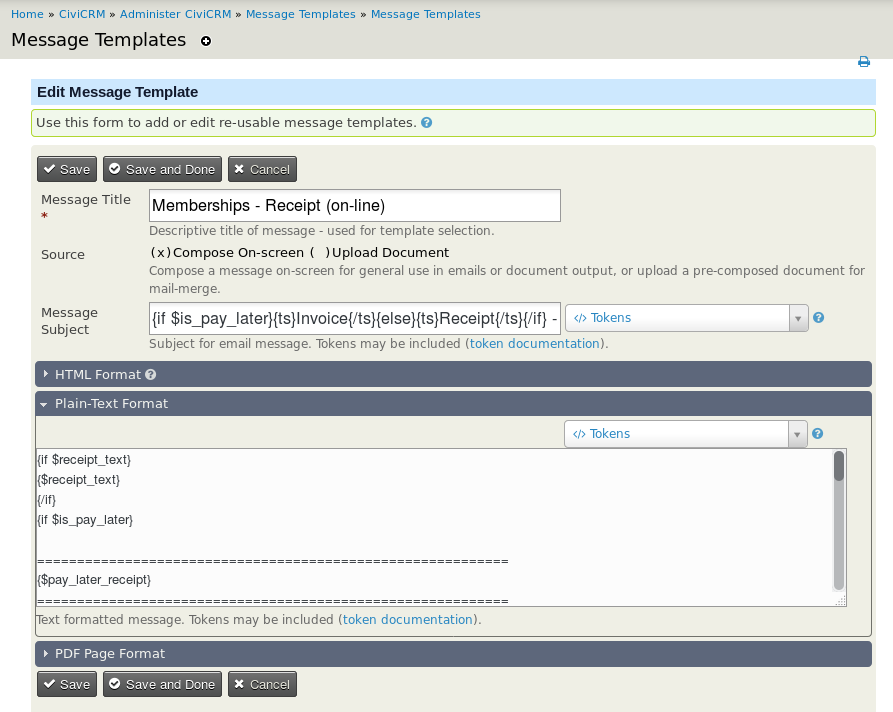
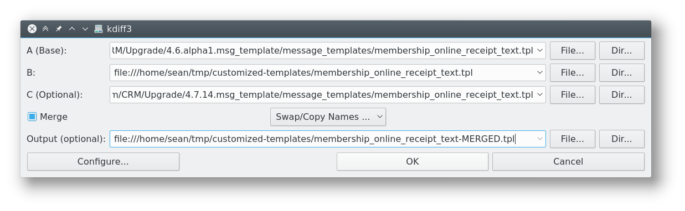
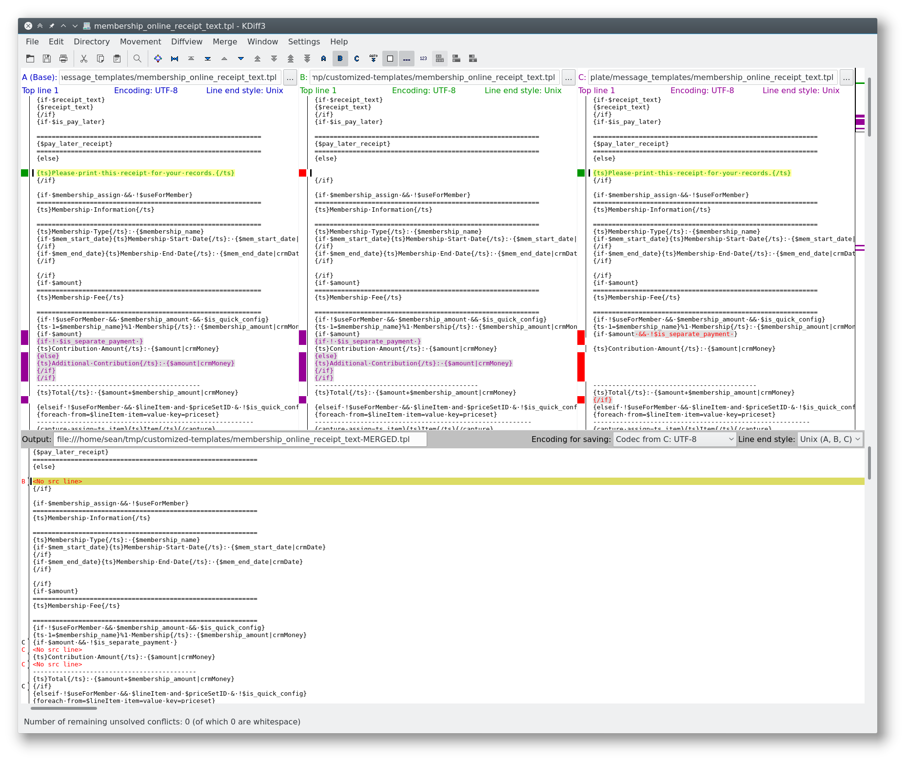

# Updating system workflow message templates

[System workflow message templates](https://docs.civicrm.org/user/en/latest/email/message-templates/) are templates for emails that CiviCRM sends regularly, such as contribution receipts and event registration confirmations. CiviCRM occasionally changes these templates in new releases. Users can also change them.

If a user has customized a template, CiviCRM stops applying updates to that template during version upgrades. This preserves the customization, but means the template misses updates from CiviCRM core, which are sometimes important.

For each version upgrade, merge your template customizations with CiviCRM's template changes:

1. Determine your currently-installed CiviCRM version (after the upgrade) *and* your previously-installed CiviCRM version (before the upgrade).

1. Assess changes made to your templates by both users and the CiviCRM upgrade. The following two checks can be done in either order. If you have relatively few user customizations, look through those first. If the upgrade spans relatively few releases, look through CiviCRM's changes first.

    * See which templates _users_ have customized. Navigate to **Administer &gt; Communication &gt; Message Templates** and click the **System Workflow Message** tab. Look for rows with *&quot;Revert to default&quot;* and *&quot;View Default&quot;* links.

        

    * See which templates _CiviCRM_ has changed.

1. Identify templates changed by _both_ users and CiviCRM. Most commonly, there will be none, and you can stop here. For each template with changes from both, complete the remaining steps.

    !!! note
        Each message template has _two_ separate pieces of text: the HTML version and the text version. Note changes to each, as you will need to process them separately.

1. Understand the three versions needed for a merge. When two parties change a piece of text in different ways, the relevant versions are **(A)** the &quot;base&quot; version before either change, **(B)** the version changed by one party (for example, _users_), and **(C)** the version changed by the other party (for example, _CiviCRM core_). The goal is to merge **(B)** and **(C)** into a new version containing all the changes.

    If **(B)** and **(C)** change independent parts of the text, the right software can merge them automatically. It needs **(A)** to determine whether this is possible. If **(B)** and **(C)** change the same text in different ways, there are &quot;merge conflicts&quot;.

1. Use a 3-way diff/merge application. [KDiff3](http://sourceforge.net/projects/kdiff3) is a cross-platform application for this purpose. Install KDiff3, or use a similar application of your choice.

1. Find the base version, **(A)**, of the template before changes by users or the CiviCRM upgrade. Look in the `CRM/Upgrade` directory for the most recent version of the template *before* the CiviCRM version you had prior to the upgrade.

1. Find the version, **(B)**, changed by your users. On the Message Templates screen, click **Edit** next to the customized template.

    

    Copy the template text into a temporary file on your computer.

1. Find the version, **(C)**, changed by your CiviCRM upgrade by looking in the `CRM/Upgrade` directory, as before.

1. Load all three files into your diff/merge program.

    

    In KDiff3, it is helpful to check the **Merge** box and specify an output file, as shown in the screenshot above.

1. In most cases, the application can automatically merge changes from **(B)** and **(C)**. In rare cases, use it to resolve merge conflicts manually. When the merge is complete, save its output to a separate file.

    

1. Copy the merge output back into the Message Template screen in CiviCRM, and save.

<!-- Source: upgrade/index-part2.md -->
