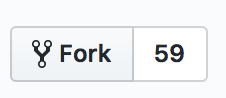
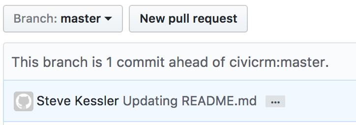

# Contributing to the CiviCRM user guide

This page is a starting point for contributing to the CiviCRM user guide. More advanced documentation for contributing is in the [CiviCRM developer guide](https://docs.civicrm.org/dev/en/latest/documentation/).

## Style guide {:#style_guide}

When proposing changes, follow the [Documentation style guide](https://docs.civicrm.org/dev/en/master/best-practices/documentation-style-guide/).

## Contributing single changes {:#single_changes}

1. [Sign up for an civicrm.org-account](https://civicrm.org/user/register) (if you don't already have one) and [login at lab.civicrm.org](https://lab.civicrm.org/users/sign_in).
2. Find the page in the manual that you want to edit. For example, [Menu, Dashboard and Dashlets](../the-user-interface/menu-dashboard-and-dashlets.md).
3. Click the pencil icon next to the page title.

   

4. You will be taken to a GitLab editing screen at lab.civicrm.org. Make your changes, describe your changes in a descriptive commit message and *commit changes*.

This will create a merge request for your changes, which will be published as soon as they are reviewed by someone on our documentation team.

## Contributing multiple changes {:#multiple_changes}

1. [Sign up for an civicrm.org-account](https://civicrm.org/user/register) (if you don't already have one) and [login at lab.civicrm.org](https://lab.civicrm.org/users/sign_in).
2. Create a *Fork* with the fork button on the top right of the page.

   

3. In your [git client](https://git-scm.com/download/gui/linux) clone the CiviCRM user guide repository to your computer.
4. Locate the Markdown file (`.md`) in your file system that you want to edit by matching it to the file that that you want to change. For example, if you want to edit ["What is CiviCRM?"](../introduction/what-is-civicrm.md) you would find `<your_file_system>/docs/getting-prepared/is-civicrm-for-you.md`.
5. Make one or more related changes and commit them in your git client.
6. Push your changes from your git client to your fork.
7. In [GitLab](https://lab.civicrm.org) click *merge request* to create the new merge request.

   

8. Click **merge request**.
9. Leave a descriptive message and then click **Create merge request**.

Your PR will be reviewed by someone on the documentation team and published once they are approved.

## Additional resources {:#additional_resources}

Additional resources on how CiviCRM does documentation and Markdown can be found in the [developer docs](https://docs.civicrm.org/dev/en/latest/documentation/#resources).

## Versioning (which version should I edit?) {:#versioning}

All edits based on the current version of CiviCRM should be committed against the master branch. The [Developer guide](https://docs.civicrm.org/dev/en/latest/documentation/#versions) has more detailed information.

<!-- Source: the-civicrm-community/contributing-to-this-manual.md -->
