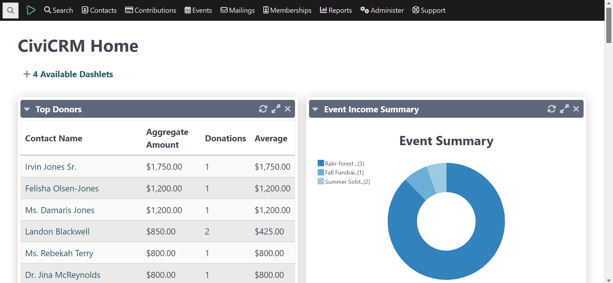
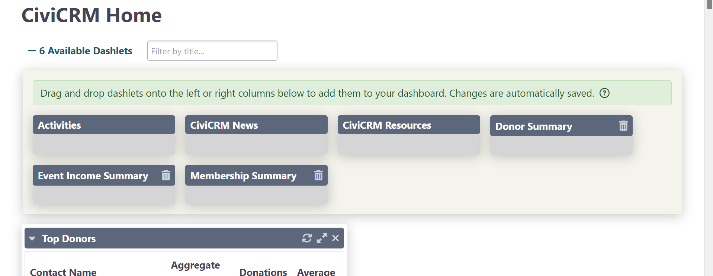

# The home dashboard & dashlets {:#dashlets}

When you first log into CiviCRM, you see the dashboard (**CiviCRM Home**). It displays information about your site and CiviCRM through “dashlets”: reports you can display on your home dashboard. Many dashlets come with CiviCRM by default, and you or your administrator can create others for your organization.

Examples of dashlets that come with CiviCRM include:

- **Donor Report:** A bar graph of the amount of total contributions.
- **Activities:** A list of recent activities recorded by CiviCRM. These could include emails sent to constituents, donations made or meetings scheduled in CiviCRM.
- **Membership Report:** A table summarising information about Members tracked by CiviCRM, broken out by month. It includes the number of Members of each type, total amounts of payments made and the number of contributions made, among other things.

## Add and refresh dashlets

Click **Configure Your Dashboard** to see a list of dashlets. Drag dashlets into the right or left column of your dashboard.

Click **Done** to save. You will see updates to your dashlets when you log in. To check for more recent changes, click **Refresh Dashboard Data** to reload each dashlet and pull in new information.

For performance reasons, dashlets are cached. To change how often a dashlet refreshes, edit its report. For example, for the Contribution Summary report:

1. Go to **Reports** > **Contribution Reports** and click **Contribution Summary**.
2. Under the **Access** tab, find **Cache dashlet for**. If that option is unavailable, first select **Available for Dashboard?**.
3. Click **Actions** > **Save**.

## Create a dashlet from a report

Any CiviReport can be made available as a dashlet.

1. Click **Reports** > **My Reports**, then click **New Report**.
2. Select the report template you want to use.
3. Configure the report using the **Columns**, **Sorting** and **Filters** tabs. For example, you can use the “Date Received” filter to show data for “This Quarter” or “This Year”.
4. Click **View results**.
5. Choose Tabular, Bar Chart or Pie Chart from the dropdown to the right of the Actions dropdown.
6. At the bottom of the **Access** tab, select **Available for Dashboard?**. Users with permissions to see that information will be able to add the dashlet. See [permissions](../initial-set-up/permissions-and-access-control.md) for more information.
7. Click **Actions** > **Create Report**.

Then add the dashlet to your dashboard:

1. In the menu, click the CiviCRM logo, then **CiviCRM Home**.
2. Click **Configure Dashboard**. Drag the dashlet from “Available Dashlets” to the column where you want it.
3. Click **Done**.

See [Reporting](../reporting/what-is-civireport.md) for more details on working with reports.

!!! Note
    You can now use SearchKit with FormBuilder to add dashlets. See [FormBuilder](https://docs.civicrm.org/user/en/latest/the-user-interface/creating-new-forms/) for details.

<!-- Source: the-user-interface/menu-dashboard-and-dashlets-part2.md -->
