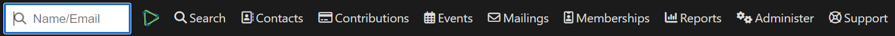
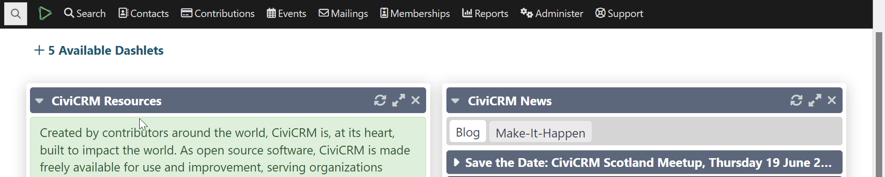

# Navigation menu

The navigation menu is a small bar at the top of every CiviCRM “back office” page. It groups major areas of functionality alongside search and administration.

The menu includes:

- **Quick Search** — Look up a name, email or other custom fields.
- **Menu Search and Logout** — Search the entire CiviCRM menu and log out.
- **Search** — Search your CRM data.
- **Contacts** — Find, add and manage contacts.
- **Contributions** — Search contributions and manage contribution pages.
- **Events** — Create and manage event registrations.
- **Mailings** — Send bulk emails and view mailing history.
- **Reports** — Generate and access reports.
- **Administer** — Configure system settings and custom data.

The [Quick Search](https://docs.civicrm.org/user/en/latest/the-user-interface/searching/#quick-search) field is at the far left of the navigation menu. See the *Searching* chapter for more details.

## Quickly finding menu items

Hover over the CiviCRM logo in the top navigation, next to the quick search bar. A panel appears with a search field and a list of available menu items.

1. Click the search field.
2. Type part of a menu item name, such as “display preferences” or “groups”. The list filters to matching items.
3. Click an item to go directly to its page.

## Modifying the menu

To add, disable or rearrange menu items, go to **Administer** > **Customize** > **Navigation Menu**.

!!! Note
    Changes to the navigation menu are visible to everyone with the appropriate permissions to see the menu. Be careful when modifying it.

<!-- Source: the-user-interface/menu-dashboard-and-dashlets.md -->
