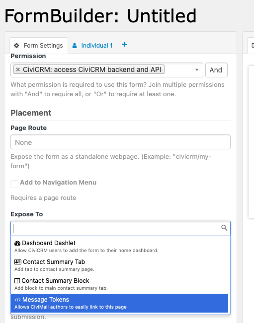
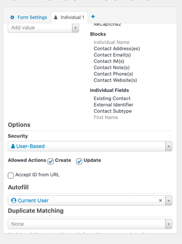
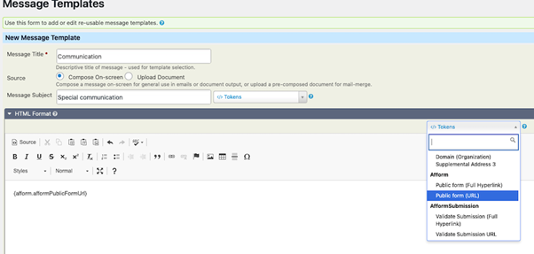

# Message token

Create a token for the form in the “Expose” field. This token allows CiviMail authors to link to the form.

You need to set **Autofill** to **Current User** in the **Individual** tab. But you do not need to **&quot;accept Id from URL”**. If you do not need it, it is more secure not to **&quot;accept Id from URL&quot;**.

In a message template, you can select the **Afform Token** with the name of your form. Two tokens are created: URL and Hyperlink.

When the recipient clicks the link, they access the form with the contact’s data populated.

<!-- Source: the-user-interface/message-token.md -->
