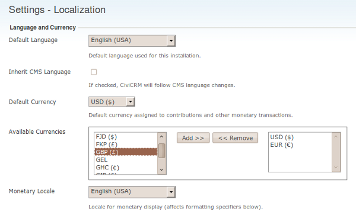

# Translating CiviCRM

CiviCRM is written with English-language code and strings for display. Using,
[Transifex](https://explore.transifex.com/civicrm/civicrm/) CiviCRM is
able to translate the entire interface into dozens of different
languages for the use of many different organizations worldwide. Each local
language can be installed locally, and then CiviCRM is able to use this base.

## Localizing CiviCRM

After completing your [initial setup](../initial-set-up/installation-and-basic-set-up.md)
of CiviCRM you should be able to further configure your instance with regional
settings.

The Localization screen (shown in the following screenshot) lets an administrator select
the right locale for the language and country of the organization using CiviCRM. Go to:
**Administer > Configure > Global Settings > Localization**.



## Translating Your CiviCRM

CiviCRM accommodates different languages, however the developers rely on
the community to translate the text displayed where translations are missing or
a specific language is not integrated.

Presently, there are several different ways to translate your own custom
labels and strings into the languages you wish. We are aiming to migrate this all
into one system eventually.

+ [FormBuilder](../translations/translating-formbuilder.md)
+ [Custom Fields and Profiles](../translations/translating-customfields.md)
+ [Option Values and Groups](../translations/translating-options.md)

## Mapping Languages to Specific Regional Translations

In some cases, you might want to properly map the language you have added
to CiviCRM to a more localized version. A common example is that of
Canadian French being much different than that of French from France.

To use fr_CA instead of fr_FR (for France French), which is the default
you can modify your `civicrm.settings.php` file with the following code.

```
  define('CIVICRM_LANGUAGE_MAPPING_FR', 'fr_CA');
```

See [CRM-9558](https://issues.civicrm.org/jira/browse/CRM-9558) for more information.

# Technical

As a basic understanding the way that words are retrieved are as the following:

1. The system takes the existing string within a translation call (in English)
2. It checks the current language of the user, and then if it's different than the default
(English US) that all strings are referenced against it will attempt to find the appropriate
translation.
3. It first scours the `.mo` files that are downloaded and installed for different languages
4. If no matching translation is found, it will then attempting to lookup the strings from the
translation repository, and if none are found there it will then continue to look for the strings
within the particular (older) translation columns for each custom field and/or option value/group

# FAQ

## What if I notice strings are not translated

If it's within a custom extension then normally you can contact the author, and propose translations.

CiviCRM is also built by volunteers and we encourage the community to provide translations via
the online translation tool [Transifex](https://explore.transifex.com/civicrm/civicrm/)
to find out about your language of interest. Download and install it on your CiviCRM installation to find out how well it will suit your needs.

More information can be found [here](../the-civicrm-community/localising-civicrm.md).

<!-- Source: translations/localizing-civicrm.md -->
