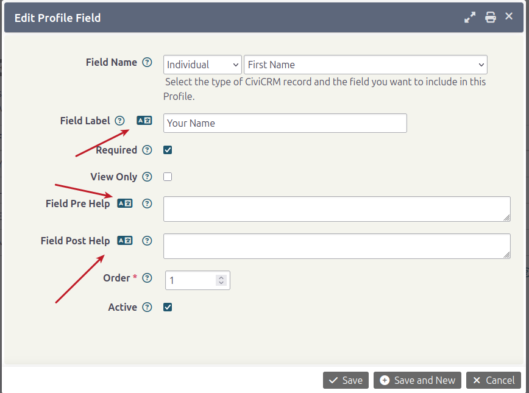

# Translating profiles

Profiles work similarly to `Custom Fields`, with one caveat: if you do not change the default _Label, Description, Pre/Post help text_, the profile uses the translation already available in core or in the previously translated `Custom field`.

## Translating labels

If you change the labels of fields added to a `Profile`, translate them as follows:

1. Go to **Administrator &gt; Customize Data and Screens &gt; Profiles**.
2. Click the `Fields` link for the Profile you want to translate.
3. Click the `Edit` link for a Field. In this example, `First Name` has been changed to `Your Name`.
4. Click the corresponding translate button. In the popup, translate the label or value.

    

5. Click **Save**.
6. Repeat the process for the other fields whose default labels you modified.
7. View the profile in another language to see the fields with your translations.

<!-- Source: translations/translating-customfields-part2.md -->
