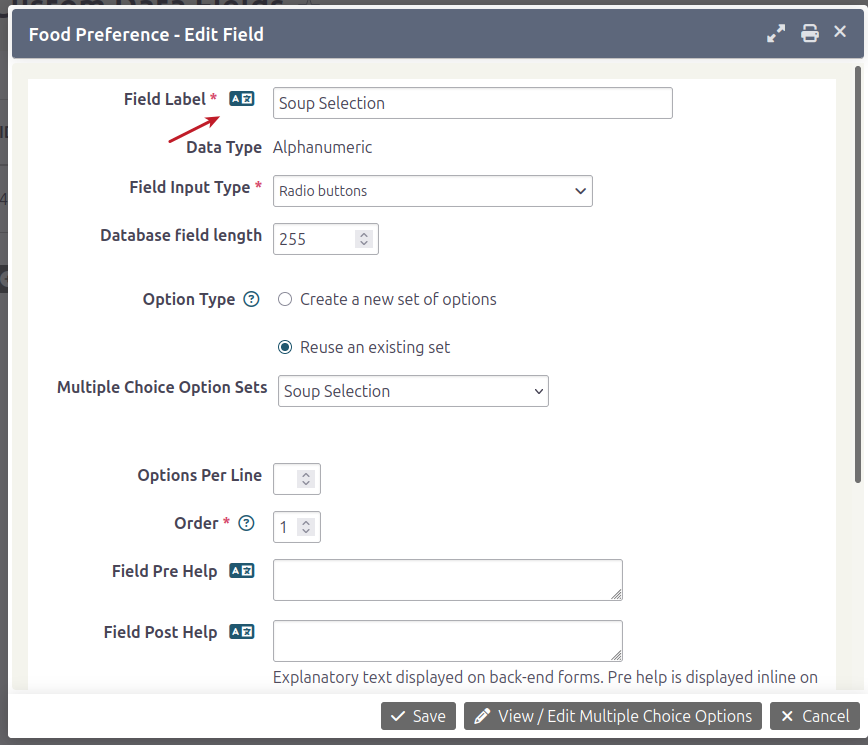

# Translating custom fields and groups

You can translate existing custom fields and custom groups. After a field has been added, the interface lets you add translations. By default, it normally copies the original labels and values from the default language to the additional languages.

## Translating a custom field

**Note:** This process assumes you have already set up a [multilingual system](https://docs.civicrm.org/user/en/latest/initial-set-up/installation-and-basic-set-up/).

1. Go to **Administrator &gt; Customize Data and Screens &gt; Custom Fields**.
2. Edit the `Custom Group` you want to translate.
3. For each custom field, click the `Edit Field` link.
4. Click the corresponding translate button.

    

5. In the popup, translate the label or value.

    

6. Click **Save**.
7. Repeat the process for the other translation options and additional fields.
8. View the group in another language to see the fields with your translations.

## Translating a custom group

Follow the same process as for `Custom fields`, but click the `Settings` link for the `Custom Group`. You can translate any fields that have the same language button.

<!-- Source: translations/translating-customfields.md -->
