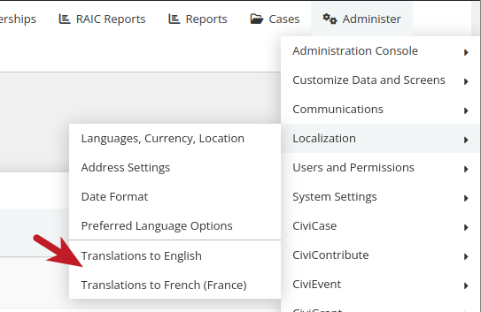
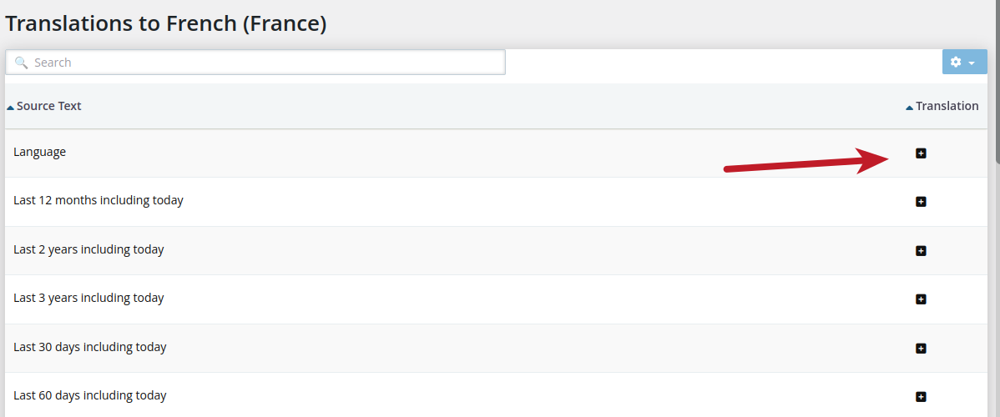

# Translating FormBuilder

As of 6.10, you are able to use the new [FormBuilder](..//the-user-interface/formbuilder/creating-data-entry-forms.md) for labels, and other fields. Normally, during the upgrade the strings should be populated into the new translation system, but I will give instructions on how to go through the entire process.

**Note:** This process assumes you have already setup a [multilingual system](https://docs.civicrm.org/user/en/latest/initial-set-up/installation-and-basic-set-up/).

## Build your form

1. Go to **Administer &gt; Customize Data and Screens &gt; FormBuilder**.
2. Edit your Form.
3. Make _changes_ to any of the labels, options, and/or descriptions to the Form fields.
4. Click **Save**.

The strings from this Form will now have been saved into the new translation repository.

**Note:** Only labels that are changes to the _field label, options and/or descriptions_ are saved, as the default translations are used when not modified.

## Translate your form

Each time a new language is added there is now a corresponding translation repository _for each different language_ that is used presently by FormBuilder, Searchkit (soon), and Scheduled Reminders.

1. Go to **Administer &gt; Locations &gt; Translations to yourlanguage** (where _yourlanguage_ will be any of the languages presently installed).

   

2. Click on the `+` in order to translate to another language.

   

## Technical details

- FormBuilder will search for the appropriate translations in the translation system, and then check internal or extension translation files (_.po_ files) next. This gives us an opportunity to make specific translations for individual fields on each Form on a case-by-case basis and ensure that they are respected if setup by the user.
- A majority of the strings in FormBuilder can be translated, such as: _options, titles, custom text, pre/post text, and labels_.
- If you find a string that should be translated that is not, please open a ticket [here](https://lab.civicrm.org/dev/core/-/issues/).

<!-- Source: translations/translating-formbuilder.md -->
