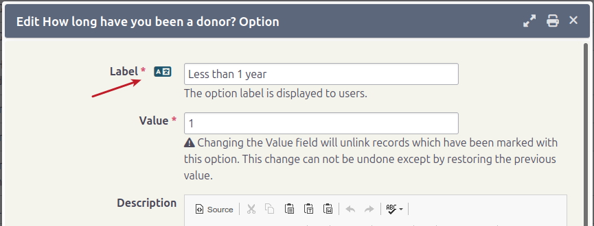
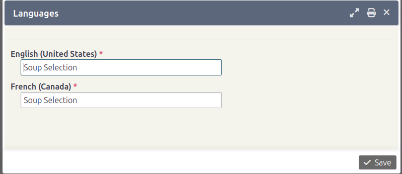

# Translate option values and groups

When you create new `Pricesets` or `Option Values` in a multilingual system, you also need to translate them.

## Translate option values

**Note:** This process assumes you have already set up a [multilingual system](https://docs.civicrm.org/user/en/latest/initial-set-up/installation-and-basic-set-up/).

1. Go to **Administrator &gt; Customize Data and Screens &gt; Dropdown Options**.
2. Find the specific Option group you want to modify and click `Edit Options`.
3. Click the `Edit` link for an option. Within the Label, click the translation button.

   

4. A popup will appear where you can translate the label.

   

5. Click **Save** after translating.
6. Repeat the process for the other options.
7. View the group in another language to see the fields with your translations.

## Translate an option group

This process is similar to translating an `Option value`. Click the `Settings` link to modify the corresponding `Group Title` and `Description`.

<!-- Source: translations/translating-options.md -->
